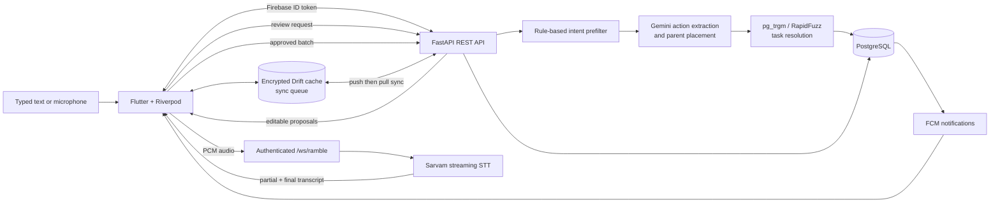

# Amble

Amble is a voice-first, AI-assisted task manager for capturing messy thoughts and turning them into an editable hierarchy. Its Flutter client supports typed or spoken input, review-before-write AI proposals, node/flat/calendar views, Firebase-authenticated accounts, and encrypted offline storage. A FastAPI backend owns task rules, multi-user persistence, AI interpretation, transcription, search, notifications, and sync.

The central design choice is proposal before mutation: AI interprets an input, but the user can edit, deselect, or redirect every proposed action before the backend applies the batch.

## Why this exists

Most task managers ask you to organize a thought at the exact moment you are trying not to lose it. Pick a list. Choose a priority. Decide whether it is a task, project, or subtask. That works for tidy inputs; real thoughts often arrive as a ramble: “book the tickets, remind me to call the doctor, and break the launch plan into steps.”

Amble was built around capture first, structure second. You can speak or type the messy version, let the system separate it into possible actions, and then review what it understood. Existing tasks and life domains give the AI enough context to suggest where something belongs, but the proposal screen keeps the user in charge before anything changes.

The hierarchy, offline cache, and sync system support that same idea over time. The app should be quick enough for a passing thought and structured enough for a plan with many levels, without turning maintenance of the task system into another task.

## What it does

- Accepts free-form keyboard input or live microphone audio.
- Streams 16 kHz PCM audio over an authenticated WebSocket to Sarvam AI (`saaras:v3`) for English transcription.
- Uses Gemini 2.5 Flash Lite to extract multiple `add`, `complete`, `edit`, `delete`, or `breakdown` actions from one brain dump.
- Classifies tasks into eight life domains and performs a second, focused AI pass to place new tasks under an appropriate existing parent.
- Resolves references to existing tasks with PostgreSQL trigram search or a RapidFuzz fallback.
- Lets the user review and edit proposals before committing them as one atomic batch.
- Stores tasks as an arbitrary-depth tree with cascading completion, archive/restore, circular-parent protection, and ancestor reactivation.
- Provides node, flat, and calendar views with client-side filtering and sorting.
- Keeps an encrypted local Drift/SQLCipher cache and queues optimistic mutations for background synchronization.
- Supports due-date push notifications, deep links, structured logs, metrics, and optional Sentry reporting.
- Includes Android shortcuts, a home-screen widget, and a Quick Settings tile for opening Ramble quickly.

## Architecture



## How task interpretation works

All typed and transcribed input uses the same two-endpoint workflow:

1. `POST /api/agent/braindump` receives a transcription, with optional category or parent context.
2. A deterministic prefilter rejects obvious gibberish before spending an AI request.
3. The backend builds the user's full task-tree context.
4. Gemini Stage 1 extracts one or more actions, fields, domains, and separate action/domain confidence scores.
5. For new tasks, Gemini Stage 2 sees only the chosen domain subtree and proposes a parent conservatively.
6. Complete/edit/delete references are resolved against the user's active tasks. `breakdown` generates a set of proposed child tasks.
7. The Flutter review screen lets the user change or omit proposals.
8. `POST /api/agent/braindump/submit` applies the reviewed batch in one database transaction. If any action fails, the batch is rolled back.

AI suggestions therefore do not bypass normal task validation or directly mutate the database during interpretation.

## Voice protocol

The client derives `ws://.../ws/ramble` (or `wss://`) from `API_BASE_URL` and uses a first-message authentication handshake, so Firebase tokens are not placed in the URL.

```text
client -> {"type":"auth","token":"<firebase-id-token>"}
server -> {"type":"auth_ok"}
client -> {"type":"start"}
client -> {"type":"audio","data":"<base64-pcm-s16le>"}  (repeated)
server -> {"type":"transcription","text":"..."}          (streaming)
client -> {"type":"stop"}
server -> {"type":"final_transcript","text":"..."}
```

Sessions are limited to five minutes. The backend also enforces message size, bandwidth, authentication timeout, and per-user connection limits.

## Technology

| Layer | Implementation |
|---|---|
| Mobile client | Flutter, Dart, Material 3 |
| State and networking | Riverpod, Dio, `web_socket_channel` |
| Offline data | Drift, SQLite/SQLCipher, platform secure storage |
| Authentication | Firebase Authentication / Firebase Admin |
| API | FastAPI, Pydantic, SQLAlchemy async, Uvicorn |
| Primary data | PostgreSQL 15 with Alembic migrations and `pg_trgm` search |
| AI interpretation | Google Gemini 2.5 Flash Lite with structured output |
| Speech-to-text | Sarvam AI `saaras:v3` streaming translate mode |
| Background services | Redis lock for notification workers, FCM push notifications |
| Operations | structlog, Prometheus metrics, optional Sentry |

## Repository layout

```text
.
├── backend/
│   ├── routers/             # tasks, categories, AI, WebSocket, notifications, account
│   ├── services/            # task rules, AI pipeline, search, STT, notifications
│   ├── models/              # SQLAlchemy tables and Pydantic contracts
│   ├── migrations/          # active Alembic migration history
│   ├── evaluation/          # brain-dump datasets and evaluation runners
│   ├── tests/               # unit, API, E2E, concurrency, and performance tests
│   ├── scripts/             # backup and evaluation helpers
│   └── docker-compose.yml   # API, PostgreSQL, and Redis
├── frontend/
│   ├── lib/
│   │   ├── database/        # encrypted Drift schema and DAOs
│   │   ├── providers/       # Riverpod state and derived task views
│   │   ├── screens/         # auth, home, tree, flat, calendar, archive, Ramble
│   │   ├── services/        # API, WebSocket, sync, auth, audio, notifications
│   │   └── widgets/         # reusable task, input, navigation, and loading UI
│   ├── test/                # Dart unit and widget tests
│   └── integration_test/    # device-level flows
├── render.yaml              # Render backend/database blueprint
└── DEPLOYMENT.md            # production operations notes
```

## Local setup

### Prerequisites

- Docker with Docker Compose
- Flutter with an Android emulator/device or iOS simulator/device
- A Firebase project with Authentication configured
- A Firebase Admin service-account JSON file for the backend
- Google Gemini and Sarvam AI API keys

### 1. Configure and start the backend

```bash
cd backend
cp .env.example .env
```

Fill in the values in `.env`, especially `POSTGRES_PASSWORD`, `GEMINI_API_KEY`, `SARVAM_API_KEY`, and `FIREBASE_PROJECT_ID`. Place the Firebase Admin key at:

```text
backend/firebase-service-account.json
```

That file is gitignored and is mounted by Compose at `/app/firebase-service-account.json`. Then start the stack:

```bash
docker compose up --build -d
docker compose ps
curl http://localhost:8001/health
```

The backend image runs `alembic upgrade head` before starting Uvicorn. The API is exposed on <http://localhost:8001>; PostgreSQL and Redis bind only to localhost on ports 5433 and 6379.

Set `DEBUG=True` in `backend/.env` if you need the local OpenAPI UI at <http://localhost:8001/docs>.

### 2. Configure Firebase for Flutter

The app expects generated Firebase client configuration in `frontend/lib/firebase_options.dart` and the appropriate platform files, such as `frontend/android/app/google-services.json`. To use your own Firebase project, regenerate them with FlutterFire from the `frontend/` directory:

```bash
flutterfire configure
```

Enable the sign-in providers you plan to use in the Firebase console. The client sends Firebase ID tokens on REST requests and in the initial WebSocket message.

### 3. Run the Flutter client

```bash
cd frontend
flutter pub get
flutter run
```

The default API URL is `http://10.0.2.2:8001/api`, which reaches the host from an Android emulator. Override it for other targets:

```bash
# iOS simulator
flutter run --dart-define=API_BASE_URL=http://localhost:8001/api

# Physical device on the same LAN
flutter run --dart-define=API_BASE_URL=http://192.168.1.10:8001/api
```

Non-local production URLs must use HTTPS; the client rejects insecure public API URLs.

## User workflow

- Tap the input control to type a brain dump, or long-press it to open live Ramble recording.
- Review detected actions, matched tasks, domain/parent choices, dates, priorities, and subtasks before submitting.
- Browse the hierarchy in Node view, inspect everything in Flat view, or group active work by due date in Calendar view.
- Complete, edit, move, archive, restore, or delete tasks from task details. Tree operations preserve hierarchy invariants and cascade where appropriate.
- Local mutations update the UI immediately, enter the encrypted sync queue, and are pushed when the backend is reachable. Sync then pulls server changes; full reconciliation occurs when needed and at least every 24 hours.

## API overview

Task, category, AI, notification, account, and client-log endpoints require a Firebase Bearer token. `/health` and `/metrics` are operational endpoints; the debug-only OpenAPI pages are also unauthenticated.

| Area | Main endpoints |
|---|---|
| Tasks | `GET /api/tasks`, `POST /api/tasks`, `PATCH /api/tasks/{task_id}`, plus completion/archive/restore/delete routes |
| Search and bulk work | `GET /api/tasks/search`, `GET /api/tasks/stats`, `POST /api/tasks/bulk` |
| Categories | `GET /api/categories`, `POST /api/categories`, `DELETE /api/categories/{category_id}` |
| AI proposals | `POST /api/agent/braindump`, `POST /api/agent/braindump/submit` |
| Live transcription | `WS /ws/ramble` |
| Notifications | `POST /api/notifications/token`, `DELETE /api/notifications/token` |
| Account | `DELETE /api/account` |
| Operations | `GET /health`, `GET /metrics`, `POST /api/logs` |

The API supports filtering, multi-field sorting, pagination, due-date ranges, archived-task queries, and category/task search. Generated OpenAPI documentation is enabled only when `DEBUG=True`.

## Data model and synchronization

The server uses three main PostgreSQL tables:

- `tasks`: UUID, owner, title/description, optional parent, category, status, due/completion/archive timestamps, priority, tags, estimate, transcription, and JSONB AI-placement metadata.
- `categories`: per-user category names and display positions, unique per user.
- `fcm_tokens`: per-device notification token, platform, timezone, and ownership.

`tasks.parent_id` is self-referential and uses `SET NULL` on direct database deletion. Service-layer operations add cycle checks and explicit descendant behavior.

On-device storage mirrors tasks and categories in an encrypted Drift database and adds:

- `sync_queue` for pending create/update/complete/archive/restore/delete operations.
- `sync_meta` for pull checkpoints and full-sync timestamps.

Queue compaction removes redundant local operations before upload. The sync engine avoids overwriting newer optimistic state, preserves pending local changes during pulls, and distinguishes retryable network/server failures from permanent validation failures.

## Configuration

Backend settings are defined in `backend/config.py` and loaded from `backend/.env`.

| Variable | Required | Default / purpose |
|---|---|---|
| `POSTGRES_PASSWORD` | Yes for Compose | PostgreSQL password used to build `DATABASE_URL` |
| `GEMINI_API_KEY` | Yes | Task interpretation and subtask generation |
| `SARVAM_API_KEY` | Yes | Streaming speech-to-text |
| `FIREBASE_PROJECT_ID` | Yes | Firebase token verification |
| `APP_ENV` | No | `development`; production enables stricter behavior |
| `DEBUG` | No | `False`; controls debug responses and API docs |
| `SEARCH_ENGINE` | No | Compose defaults to `pg_native`; `fuzzy` is available |
| `CORS_ORIGINS` | No | Comma-separated exact HTTP(S) origins |
| `REDIS_URL` | No | Compose supplies Redis for distributed notification locking |
| `SENTRY_DSN` | No | Enables Sentry when set |
| `MAX_CATEGORIES` | No | `8` |

Additional timeout, database-pool, rate-limit proxy, notification interval, and WebSocket connection settings are available in `backend/config.py`.

## Testing and evaluation

Backend tests run inside the existing container and create a separate PostgreSQL database named `todo_test`:

```bash
docker exec todo-backend python -m pytest tests/ -v --tb=short --ignore=tests/performance
```

Run Flutter analysis and tests from `frontend/`:

```bash
flutter analyze
flutter test
```

The device-level suite and its isolated test backend are documented in `frontend/integration_test/README.md`. The brain-dump evaluation harness can run all cases or a selected category:

```bash
docker exec todo-backend python evaluation/run_eval.py
docker exec todo-backend python evaluation/run_eval.py --filter-category add
docker exec todo-backend python evaluation/run_eval.py --no-llm
```

## Operational and security notes

- Task text and hierarchy context are sent to Google Gemini when using AI interpretation. Voice audio is streamed to Sarvam AI. Review both providers' data-handling terms before using sensitive information.
- Firebase client configuration is not a substitute for backend authorization. The API verifies each ID token and scopes queries by Firebase UID.
- Keep `firebase-service-account.json`, `.env`, API keys, and signing material out of version control.
- The backend masks unexpected errors in non-debug mode, applies request/rate limits and security headers, and rejects wildcard or localhost CORS origins in production.
- Offline support covers task mutations and cached reads. AI interpretation and live transcription still require a reachable backend and external providers.
- Automatic archive purging and notification checks run inside the API process. Redis coordinates notification work across replicas when configured.
