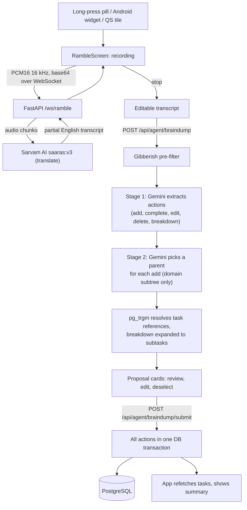

# Amble (repo: `todo`)

A voice-first, hierarchical todo app. Hold the button, say everything on your mind ("finished the tax forms, add buy milk, push the dentist to next Monday, break down the Japan trip"), check the cards it proposes, and submit. The app adds, completes, edits, deletes and breaks down tasks in one go.

- **Flutter** app for Android and iOS (`frontend/`)
- **FastAPI + PostgreSQL** backend (`backend/`)
- **Sarvam AI** `saaras:v3` for streaming speech-to-text (translate mode, so Hindi/Hinglish comes out as English)
- **Google Gemini** `gemini-2.5-flash-lite` for turning the transcript into structured task actions
- **PostgreSQL `pg_trgm`** (or RapidFuzz) for matching "the dentist thing" to an actual task
- **Firebase** for auth, push notifications, analytics and crash reporting

The app was called VOKL until March 2026; some leftovers still use that name.

## How it works



Tasks sit in an unlimited-depth tree under 8 fixed domains: career, finance, health, relationships, growth, recreation, home, community. Completing a task via voice completes its active subtasks; reactivating a task reactivates its completed ancestors.

Manual edits (checkbox, swipe to archive, the add-task sheet) are offline-first: they are written to an encrypted local SQLite database (Drift + SQLCipher), queued, and synced to the server when online. Voice needs a connection.

More detail, including the prompts, schemas, sync rules and known issues, is in [`docs/NOTES.md`](docs/NOTES.md).

## How it got here

1. **1 Feb, Flutter-only MVP** ([0485dc3](https://github.com/tarangdeep-goel-by/todo/commit/0485dc3)): Gemini 2.5 Flash transcribed an m4a and filed one task under Work or Personal in local Drift; by the afternoon an on-device agent also handled complete, delete, edit and query ([2b08d71](https://github.com/tarangdeep-goel-by/todo/commit/2b08d71)). Deleted the same evening ([045aca6](https://github.com/tarangdeep-goel-by/todo/commit/045aca6)).
2. **1 to 7 Feb, backend and single commands** ([2ba249a](https://github.com/tarangdeep-goel-by/todo/commit/2ba249a), [b7b0ea9](https://github.com/tarangdeep-goel-by/todo/commit/b7b0ea9), [40b8191](https://github.com/tarangdeep-goel-by/todo/commit/40b8191)): FastAPI + Postgres. On-device `speech_to_text` sent one command to `/agent/process`, Gemini picked one intent, RapidFuzz found the task, and it ran immediately.
3. **25 Feb to 1 Mar, brain dump and Gemini Live** ([0b26b3c](https://github.com/tarangdeep-goel-by/todo/commit/0b26b3c), [61b636d](https://github.com/tarangdeep-goel-by/todo/commit/61b636d), [dce61a7](https://github.com/tarangdeep-goel-by/todo/commit/dce61a7), [c96c770](https://github.com/tarangdeep-goel-by/todo/commit/c96c770)): intent eval (65 cases), multi-action `/agent/braindump` that only proposes, review cards before `/braindump/submit`, audio streamed to Gemini Live plus a transliteration pass.
4. **3 Mar, one pipeline** ([c7325f2](https://github.com/tarangdeep-goel-by/todo/commit/c7325f2), [1a322a3](https://github.com/tarangdeep-goel-by/todo/commit/1a322a3)): `pg_trgm` resolves task references; the single-command path (~1,250 lines) removed as redundant; 5 domains became the current 8.
5. **4 to 7 Mar, Sarvam and hardening** ([d7f34aa](https://github.com/tarangdeep-goel-by/todo/commit/d7f34aa), [6f95412](https://github.com/tarangdeep-goel-by/todo/commit/6f95412), [4c35ab5](https://github.com/tarangdeep-goel-by/todo/commit/4c35ab5)): Sarvam `saaras:v3` translate mode replaced Gemini Live ("eliminating the separate transliteration step"); eval to 137 cases (87% to 95%); rename to Amble, Firebase Auth, atomic submit, offline-first sync.
6. **8 to 9 Mar, two-stage extraction** ([b57f052](https://github.com/tarangdeep-goel-by/todo/commit/b57f052), [716a7f9](https://github.com/tarangdeep-goel-by/todo/commit/716a7f9), [11becb1](https://github.com/tarangdeep-goel-by/todo/commit/11becb1), [fb4ca33](https://github.com/tarangdeep-goel-by/todo/commit/fb4ca33)): a 270-case MS-LaTTE eval put parent accuracy at 39.7%; a separate per-add placement call took it to 64.4%.
7. **17 Mar, Android widget, QS tile and shortcut** ([f01e69b](https://github.com/tarangdeep-goel-by/todo/commit/f01e69b)) open straight into recording via `amble://ramble`.

## Repository layout

```
backend/
  main.py                 FastAPI app, middleware, background loops (archive purge, due reminders)
  routers/                agent (brain dump), ramble (WebSocket), tasks, categories, notifications, account
  services/
    ramble_service.py     Sarvam streaming STT session
    gemini_service.py     Stage 1 / Stage 2 / subtask prompts and schemas
    agent_service.py      brain dump orchestration and batch submit
    task_service.py       tree operations, cascades, categories
    task_search_service.py  pg_trgm search
    intent_prefilter.py   gibberish filter
  models/                 SQLAlchemy models + Pydantic schemas
  migrations/             Alembic
  evaluation/             prompt eval harness and datasets
  tests/                  unit + e2e (run inside Docker)
frontend/
  lib/screens/ramble_screen.dart          the voice flow
  lib/services/ramble_websocket_service.dart
  lib/services/audio_service.dart
  lib/providers/task_store_provider.dart  single in-memory source of truth
  lib/services/sync_service.dart          push queue + delta pull
  lib/database/                           Drift tables and DAOs
  android/app/src/main/kotlin/com/amble/app/  home widget, QS tile
render.yaml               Render deploy (Postgres + Docker web service)
```

## Setup

### Prerequisites

- Docker and Docker Compose
- Flutter SDK (Dart `^3.10.8`)
- A Gemini API key and a Sarvam AI API key
- A Firebase project with Google sign-in enabled, plus a service account JSON for the backend

### Backend

```bash
cd backend
cp .env.example .env
# edit .env: POSTGRES_PASSWORD, GEMINI_API_KEY, SARVAM_API_KEY, FIREBASE_PROJECT_ID
cp /path/to/service-account.json firebase-service-account.json   # a real file, not a symlink
docker compose up --build
```

This starts Postgres (127.0.0.1:5433), Redis (127.0.0.1:6379) and the API on http://localhost:8001. The container runs `alembic upgrade head` before starting uvicorn. `/docs` is only served when `DEBUG=True`.

Optional env vars: `SEARCH_ENGINE` (`pg_native` in compose, `fuzzy` otherwise), `REDIS_URL`, `SENTRY_DSN`, `CORS_ORIGINS`, `LOG_LEVEL`, `APP_ENV`. See `backend/config.py` for the full list.

The HTTP seed scripts (`seed_tasks.*`, `seed_deep_tasks.*`) predate Firebase Auth and send no bearer token, so they will get 401s against the current API unless you adapt them. `seed_realistic.py` and `seed_showcase.py` write straight to the database.

### Frontend

```bash
cd frontend
flutter pub get
flutter run --dart-define=API_BASE_URL=http://<your-lan-ip>:8001/api
```

Without `API_BASE_URL` it defaults to `http://10.0.2.2:8001/api` (the Android emulator's address for the host). Plain HTTP is only accepted for localhost and private IP ranges; anything else must be HTTPS.

Firebase: Android config is committed (`android/app/google-services.json`, `lib/firebase_options.dart`) for the original project. Point these at your own Firebase project. For iOS, add your own `ios/Runner/GoogleService-Info.plist` (gitignored).

Release builds on Android read signing config from `android/key.properties` (see `key.properties.example`).

### Tests and evals

```bash
# backend (inside the running container)
docker exec todo-backend python -m pytest tests/ -v --ignore=tests/performance

# frontend
cd frontend && flutter test && flutter analyze

# brain dump prompt eval (calls Gemini)
docker exec todo-backend python evaluation/run_eval.py
```

### Deploy

`render.yaml` describes a Render Postgres database and a Docker web service. Set `GEMINI_API_KEY`, `SARVAM_API_KEY`, `FIREBASE_PROJECT_ID`, `FIREBASE_CREDENTIALS_JSON` (base64 service account) and `CORS_ORIGINS` in the Render dashboard. `DEPLOYMENT.md` covers backups and scaling.

## Known limitations

- `/api/agent/braindump/submit` trusts the `matched_task_id`, `parent_id` and `changes` fields sent by the client and does not check they belong to the caller. The REST task routes do check. Fix before exposing this to other users.
- Voice does not work offline, and a voice batch has no undo after submit. The review screen is the confirmation step.
- The Stage 1 prompt asks for low-confidence ADDs (0.3 to 0.5) rather than dropping unclear input, but the server then discards anything under 0.6.
- Task references resolve to the top search hit. The card shows the similarity and alternatives so you can correct it.
- Delta sync does not see hard deletes made elsewhere until the next full sync (at most a day later).
- Titles are stored in lowercase and shown in sentence case, so acronyms and names lose their capitals.
- Android has a home-screen widget and Quick Settings tile; iOS does not.

See `docs/NOTES.md` section 10 for the full list.

## Author

Tarang Goel ([GitHub](https://github.com/tarangdeep-goel-by))

The previous README listed the licence as MIT, but there is no `LICENSE` file in the repo yet.
