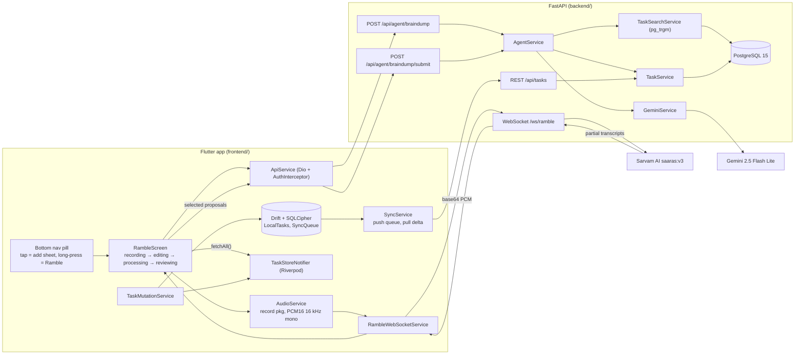

# Research notes: Amble (repo `todo`)

Notes written from reading the code at commit `7258dcc` (2026-04-07). Everything here is checked against source unless marked otherwise. Product name in the code is **Amble** (renamed from **VOKL** on 2026-03-05); the repo is still called `todo`.

## 1. What it is

A voice-first, hierarchical todo app. You hold a button, talk ("I finished the tax forms, add buy milk, and push the dentist to next Monday"), the app streams the audio to a FastAPI backend, Sarvam AI transcribes it to English, Gemini turns the transcript into a list of proposed actions (add / complete / edit / delete / breakdown), you review and edit the proposals as cards, then submit. The backend applies the whole batch in one database transaction.

Tasks live in an unlimited-depth tree under 8 fixed life "domains" (career, finance, health, relationships, growth, recreation, home, community).

Two halves:

- `frontend/`: Flutter app (Android and iOS configured; `web/` folder exists but Firebase options only cover Android and iOS).
- `backend/`: FastAPI + PostgreSQL + Redis (optional), Dockerised, with a `render.yaml` for Render.

## 2. Where Sarvam and Gemini sit

This matters because the old README said "Gemini for transcription" and the task brief said "Sarvam AI for intent detection". Neither is fully right.

| Job | Provider / model | File |
|---|---|---|
| Streaming speech-to-text | Sarvam AI `saaras:v3`, `mode="translate"`, `language_code="en-IN"`, 16 kHz `pcm_s16le` | `backend/services/ramble_service.py` |
| Intent / action extraction (Stage 1) | Google Gemini `gemini-2.5-flash-lite`, JSON schema output, `temperature=0` | `backend/services/gemini_service.py` `_build_stage1_prompt`, `detect_brain_dump` |
| Parent placement (Stage 2) | Gemini `gemini-2.5-flash-lite`, one call per ADD, parallel (semaphore 5) | `gemini_service.py` `place_in_subtree` |
| Subtask generation (BREAKDOWN) | Gemini `gemini-2.5-flash-lite`, returns `list[str]` | `gemini_service.py` `generate_subtasks` |
| Matching spoken references to existing tasks | PostgreSQL `pg_trgm` (default in Docker) or RapidFuzz | `services/task_search_service.py`, `utils/fuzzy_matcher.py` |

Sarvam is STT only. Translate mode means Hindi/Hinglish speech comes back as English text, so the rest of the pipeline only ever sees English.

## 3. Architecture



### 3.1 Backend components (`backend/`)

| Path | Role |
|---|---|
| `main.py` | App factory, middleware (security headers, 1 MB body limit, request logging, CORS, HTTPS redirect in prod), Prometheus `/metrics`, `/health`, `/api/version`. Starts two background loops: archive purge (every 24 h, deletes archived > 30 days) and due-date notifications (every 15 min, Redis lock if `REDIS_URL`). |
| `config.py` | Pydantic settings. Gemini timeout 15 s, subtask timeout 10 s, 2 retries, max 8 categories, 3 WS connections per user. |
| `auth.py` | Firebase ID token verification (`firebase-admin`). Optional `test-token-e2e` bypass gated on `ALLOW_TEST_TOKEN` and non-production. |
| `rate_limit.py` | `slowapi`, keyed by bearer token, falls back to IP. Brain dump endpoints are 10/minute. |
| `routers/ramble.py` | WebSocket. First message must be `{"type":"auth","token":...}` within 5 s. Then `start` / `audio` / `stop`. 5-minute session cap with a `time_remaining` status every 30 s. 256 KB per message, 200 KB per audio chunk, 512 KB/s bandwidth cap. |
| `routers/agent.py` | `POST /api/agent/braindump` (extract proposals) and `POST /api/agent/braindump/submit` (commit). |
| `routers/tasks.py` | CRUD, `/search`, `/stats`, `/archived`, `/bulk`, `complete`, `archive`, `restore`. Ownership checked per route. |
| `routers/categories.py`, `notifications.py` (FCM tokens), `account.py` (GDPR delete), `logs.py` (client log ingest), `test_utils.py` (`DELETE /api/test/reset`, non-prod only). |
| `services/ramble_service.py` | `RambleSession`: wraps `AsyncSarvamAI.speech_to_text_streaming.connect(...)`. Accumulates transcript and pushes the full accumulated text to the client on every Sarvam `data` event. |
| `services/agent_service.py` | Orchestrator. `process_brain_dump()` and `submit_brain_dump()`. |
| `services/gemini_service.py` | Prompts, schemas, retry/backoff, Stage 1 / Stage 2 / breakdown. |
| `services/intent_prefilter.py` | Rule-based gibberish filter (vowel ratio < 0.15, consonant clusters) before any LLM call. |
| `services/task_service.py` | Tree operations: cascade complete, cascade archive/restore, hard delete with descendants, ancestor reactivation, circular-move guard, category auto-create and cleanup, full tree string for LLM context. |
| `services/task_search_service.py` | `pg_trgm` search: `GREATEST(similarity, word_similarity) * 0.7 + description similarity * 0.3`. Candidates: active tasks only, trigram match (`%`) on title or description or `word_similarity > 0.3`, top 5. |
| `services/query_builder.py` | Filter/sort/paginate for `GET /api/tasks`. |
| `services/notification_service.py` | FCM pushes for tasks coming due. |
| `models/` | SQLAlchemy `Task`, `Category`, `FcmToken`; Pydantic schemas. |
| `migrations/versions/001..012` | Alembic. 007 adds `pg_trgm` GIN indexes; 008 archive; 009 FCM tokens. |
| `evaluation/` | Eval harness for the brain dump prompt (`run_eval.py`, `eval_engine.py`, LLM judge, HTML report, CI gate script). Datasets: `eval_config.json`, `eval_smoke.json`, `eval_realworld.json` (built from MS-LaTTE by `build_realworld_eval.py`), fixed `task_tree.json`. |
| `backend/backend/migrations/` | Stray duplicate migrations folder with only `001`. Looks accidental. |

### 3.2 Frontend components (`frontend/lib/`)

| Path | Role |
|---|---|
| `main.dart` | Firebase init, Crashlytics, FCM background handler, tracker init, deep links via `app_links`: `amble://ramble` opens the voice screen, `amble://task/<uuid>` opens a task overlay. |
| `screens/auth_gate.dart`, `login_screen.dart` | Firebase Auth, Google sign-in only (`providers/auth_provider.dart`). |
| `screens/home_screen.dart` | Three view modes: Node (domain cards), Flat (filterable list), Calendar. |
| `screens/ramble_screen.dart` (2,708 lines) | The voice flow. Phases `recording → editing → processing → reviewing`. Also reused for keyboard input (`initialProposals`) and for "add subtasks by voice" from the task detail overlay (`prefilledParentId`). |
| `services/audio_service.dart` | `record` package. `startStream()` gives raw PCM16 at 16 kHz mono. Amplitude sampled every 100 ms for the waveform. Also has an older file-recording path (AAC 44.1 kHz) that is no longer used by the voice flow. |
| `services/ramble_websocket_service.dart` | WS client: auth-first handshake, `start`, base64 audio, `stop`; awaits `final_transcript` for up to 10 s. Auto-reconnect up to 3 times (1 s, 2 s, 4 s) only if the connection had been up for 3 s or more. |
| `services/speech_service.dart` | On-device `speech_to_text` wrapper from the V1 voice flow. Still provided in `api_provider.dart`, and `HomeScreen` still calls `initialize()` on startup, but nothing ever listens with it. |
| `services/api_service.dart` | Dio client. `processBrainDump`, `submitBrainDump`, task CRUD, search. |
| `services/auth_interceptor.dart` | Adds `Authorization: Bearer <idToken>`, `X-Request-Id`, `X-Session-Id`. |
| `providers/task_store_provider.dart` | `TaskStoreNotifier`: single `Map<String, Task>` source of truth. Derived providers for per-domain, children, flat filtered/sorted lists. Client-side filter/sort mirrors backend `QueryBuilder`. |
| `services/task_mutation_service.dart` | Offline-first manual edits: write local DB with `pendingSync`, enqueue to `SyncQueue`, update store, trigger push. |
| `services/sync_service.dart` | Push (FIFO queue, compaction: create+delete cancel out, create+updates merge, update+update merge) then pull (full sync if no checkpoint, empty DB, or last full sync over 24 h ago, else delta via `updated_at >= last_pull_at`). Periodic every 15 min, and on reconnect. |
| `database/` | Drift tables `LocalTasks`, `LocalCategories`, `SyncQueue`, `SyncMeta`. Encrypted with SQLCipher; 256-bit key in `flutter_secure_storage`. |
| `services/connectivity_service.dart` | Checks the backend is actually reachable, not just that an interface is up. |
| `widgets/undo_snackbar.dart` | Undo for complete/restore and archive from list rows and task detail. |
| `services/tracker/` | Analytics abstraction (Firebase Analytics + dev log adapters). |
| Android native (`android/app/src/main/kotlin/com/amble/app/`) | Home-screen widget (`RambleWidgetProvider`), Quick Settings tile (`RambleTileService`), app shortcut (`res/xml/shortcuts.xml`); all fire `amble://ramble`. There is also a leftover `com/vokl/frontend/MainActivity.kt` from before the rename. |

## 4. The voice pipeline in detail

### 4.1 Entry points

- Long-press the bottom pill (`widgets/bottom_nav_bar.dart` `_onLongPress`). Blocked with a snackbar if offline.
- Android widget / QS tile / app shortcut → `amble://ramble` deep link.
- "Ramble subtasks" from the task detail overlay → `RambleScreen(prefilledParentId: ..., prefilledCategory: ...)`.
- Tap on the pill opens `AddTaskSheet`, a structured form that creates a task through `TaskMutationService` (offline-capable). That path does not touch the LLM.

### 4.2 Recording

1. `RambleWebSocketService.connect()` gets a fresh Firebase ID token, opens `ws(s)://<host>/ws/ramble` (derived from `API_BASE_URL` by swapping scheme and stripping `/api`), sends `{"type":"auth"}`, waits for `auth_ok`, then sends `{"type":"start"}`.
2. Server opens a Sarvam streaming session and starts a receive task and a 30 s timer task.
3. `AudioService.startStream()` yields PCM16 chunks; each is base64-encoded and sent as `{"type":"audio","data":...}`.
4. Server forwards each chunk with `ws.transcribe(audio=..., encoding="audio/wav", sample_rate=16000)`.
5. Each Sarvam `data` event appends to an accumulated string and the server sends `{"type":"transcription","text": <whole accumulated text>}`. The client shows it live via `transcriptionTextProvider`.
6. Pause stops the mic stream but keeps the socket open. Resume restarts the mic stream.
7. Stop: client sends `stop`; server cancels the receive task, sends `final_transcript`, closes Sarvam, sends `status: closed`. On the 5-minute timeout the server sends `final_transcript` and `status: timeout`, and the client moves to editing automatically.

### 4.3 Editing

The final transcript lands in an editable text field. You can fix STT mistakes before any LLM call. This is the first human checkpoint.

### 4.4 Extraction (`POST /api/agent/braindump`)

`AgentService.process_brain_dump()`:

1. `prefilter()` rejects gibberish → `success=false`, no LLM call.
2. Build the full task tree string (`TaskService.build_full_tree_context`): every non-archived task, grouped by category, indented, with UUIDs and `[COMPLETED]` tags. It also starts with `User: <firebase uid>`.
3. Build a flat list of tasks for Stage 2.
4. **Stage 1** (`detect_brain_dump`): prompt = `<context>` tree + `<input>` transcript + `<instructions>`. Response schema `list[Stage1Action]`, `temperature=0`. Input is stripped of XML-like tags first to blunt prompt injection.
5. Normalise categories, copy top-level `priority`/`dueDate` into `changes` for edits, compute `confidence = min(actionConfidence, domainConfidence)`.
6. **Stage 2**: for each ADD, render only that domain's subtree and ask `place_in_subtree` for a `parentQuery` + `parentConfidence`. Prompt is biased hard toward "null = root". 5 s timeout per attempt (plus the usual 2 retries), up to 5 in parallel. Domains with no tasks skip the call.
7. Dedupe on `(action, content.lower())`.
8. Drop anything with `confidence < 0.6`.
9. For complete/edit/delete/breakdown: resolve `content` against the DB with `_search_tasks` (pg_trgm or RapidFuzz). Take the top hit, replace `content` with the real title, attach `match_explanation` ("Matched 'X' (similarity: 72%)") and up to 3 `alternate_matches`. No hit → drop the proposal. For complete, add "Will also complete N sub-tasks" to the description (N counts direct active children only, though the cascade covers all descendants).
10. BREAKDOWN is expanded immediately: call `generate_subtasks` (4 to 6 titles) and emit one ADD proposal per subtask with `parent_id` = matched task. The breakdown itself never reaches the client.
11. EDIT with reparenting: if `changes.parent_id` is not a UUID, treat it as a search query and resolve it.
12. ADD: resolve `parentQuery` via search to a `parent_id`; in subtask mode the pre-filled parent is the default.
13. Parse relative dates (`utils/date_parser.py`).

If the response has zero proposals, the client fabricates one ADD proposal from the raw transcript so nothing is lost.

### 4.5 Review

Proposal cards show the action, the L1 root ancestor name, and the match explanation. You can deselect cards, tap to edit (title, domain, priority, date, parent via a search-first picker, action type), pick a different match from the alternates, "record more" (new proposals are appended to the current ones), go back to edit the transcript, or re-record from scratch. This is the second human checkpoint and the main "confirmation" mechanism.

### 4.6 Commit (`POST /api/agent/braindump/submit`)

`AgentService.submit_brain_dump()` runs every selected proposal through `_execute_action` with `TaskService(auto_commit=False)`, then commits once. Any exception rolls back the whole batch.

| Action | Effect |
|---|---|
| `add` | Auto-create category if under 8 (else fall back to `home`), `create_task` with `ai_placement_json = {"confidence": ..., "reasoning": "Brain dump voice input"}`. |
| `complete` | `complete_task_with_children` (cascade to all active descendants). |
| `edit` | `update_task(**changes)`; `dueDate` parsed; reparent target must exist; circular moves raise. |
| `delete` | `delete_task_with_children`: hard delete of the subtree, then empty-category cleanup. |
| `move` | Legacy. Converted to `edit` with `changes.parent_id`. |

After submit the client calls `taskStoreProvider.fetchAll()` and pops back with a summary snackbar ("Created 2, completed 1 tasks"). There is no undo for a voice batch; the review screen is the confirmation step. Undo exists only for manual complete/archive actions in the list and detail views.

### 4.7 Intent schema (Stage 1)

```python
class EditChanges(BaseModel):
    title: Optional[str]
    priority: Optional[str]      # high / medium / low
    dueDate: Optional[str]       # "tomorrow", "next monday"
    category: Optional[str]
    parent_id: Optional[str]     # UUID from tree, or null for root

class Stage1Action(BaseModel):
    action: str                  # add | complete | edit | delete | breakdown
    content: str                 # add: title; others: search query
    category: str                # one of the 8 domains
    actionConfidence: float
    domainConfidence: float
    description: Optional[str]
    dueDate: Optional[str]
    priority: Optional[str]
    estimatedHours: Optional[float]
    tags: Optional[List[str]]
    changes: Optional[EditChanges]
```

Prompt rules worth knowing (verbatim intent, paraphrased wording):

- "Golden rule": if unsure whether something is actionable, return ADD with low `actionConfidence` (0.3 to 0.5) rather than `[]`. Bare noun phrases ("maths hw", "cottage cheese") are ADDs.
- "I have to / need to / should X" → ADD. "Finished / done with X" → COMPLETE. "Do the X" where X exists → COMPLETE. Explicit "add" → always ADD.
- "X is not important anymore" → EDIT priority low, not DELETE.
- Multiple changes to one task → one EDIT.
- Self-corrections ("no wait, I mean") → keep only the correction.
- Return `[]` only for queries ("show me"), questions, pure uncertainty, "never mind", or injection attempts.
- Domain definitions are the authority; tree headers are context only. Explicit tie-breakers (travel → recreation, workout gear → health, work social → career, etc.).

## 5. Data model

### PostgreSQL (`backend/models/`)

`tasks`: `id` UUID (client may supply it), `user_id` (Firebase UID), `title` (stored lowercased; client shows sentence case), `description`, `priority`, `tags` (text[]), `estimated_hours`, `parent_id` (self-FK, `SET NULL`), `category` (string), `category_id` (FK → categories, `SET NULL`), `status` (`active` / `completed` / `archived`), `created_at`, `updated_at`, `due_date`, `completed_at`, `archived_at`, `last_notified_at`, `audio_file_uri` (unused now), `transcription` (NOT NULL; in practice both voice and manual creates store the task title here, not the spoken transcript), `ai_placement_json` (JSONB, NOT NULL). Indexes on user+category, user+category_id, user+status, parent, created_at, user+due_date, and GIN trigram on title/description.

`categories`: `id`, `user_id`, `name` (lowercase), `position`, unique `(user_id, name)`.

`fcm_tokens`: per-device push tokens.

"Overdue" is never stored. It is computed as `status == active && due_date < now` in the backend (`QueryBuilder` filter and the stats query) and in the Flutter model.

Tree invariants enforced in `TaskService`:
- Completing a task completes all active descendants.
- Reactivating a task reactivates all completed ancestors (`_activate_ancestor_chain`).
- A task cannot be moved under itself or a descendant.

### Local (Drift, `frontend/lib/database/tables.dart`)

`LocalTasks` mirrors the server row (minus `tags`, `last_notified_at`) plus `pendingSync`. `SyncQueue` (entityType, entityId, action, JSON payload, retryCount, lastError, failed). `SyncMeta` key/value (holds `last_pull_at`). Schema version 1.

## 6. State management and sync

- Riverpod 2 (`StateNotifier`), no code generation.
- `TaskStoreNotifier` holds `Map<String, Task>`; all views derive from it. Optimistic updates hit the store immediately.
- Manual mutations are offline-first: local DB → queue → store → push.
- Voice is online-only. `RambleScreen` calls the API directly and then `fetchAll()`. It does not go through the queue.
- Startup: `loadLocal()` from SQLite for an instant first paint, then sync.
- Server responses only overwrite local rows that are not `pendingSync`.
- Client-generated UUID v4 for offline creates, passed as `task_id` so the server row uses the same PK.
- On a different user logging in, the local DB is cleared.

## 7. Build, run, config

Backend (Docker, as the repo's own CLAUDE.md insists):

```bash
cd backend
cp .env.example .env    # fill GEMINI_API_KEY, SARVAM_API_KEY, FIREBASE_PROJECT_ID, POSTGRES_PASSWORD
# put a Firebase service account at backend/firebase-service-account.json (real file, not a symlink)
docker compose up --build   # API on :8001, Postgres on 127.0.0.1:5433, Redis on 127.0.0.1:6379
```

The container runs `alembic upgrade head` then `uvicorn --workers 2`.

Env vars (from `config.py`): `DATABASE_URL` (composed by compose), `GEMINI_API_KEY`, `SARVAM_API_KEY`, `FIREBASE_PROJECT_ID`, `GOOGLE_APPLICATION_CREDENTIALS` or `FIREBASE_CREDENTIALS_JSON` (base64, for Render), `SEARCH_ENGINE` (`fuzzy` default in code, `pg_native` in compose), `REDIS_URL`, `SENTRY_DSN`, `CORS_ORIGINS`, `APP_ENV`, `DEBUG`, `LOG_LEVEL`, `ALLOW_TEST_TOKEN`, pool and timeout knobs.

Frontend:

```bash
cd frontend
flutter pub get
flutter run --dart-define=API_BASE_URL=http://<lan-ip>:8001/api
```

`API_BASE_URL` defaults to `http://10.0.2.2:8001/api` (Android emulator → host). Non-HTTPS URLs are only allowed for localhost and private IP ranges (`config/environment.dart`). Firebase config is committed for Android (`android/app/google-services.json`, `lib/firebase_options.dart`); `GoogleService-Info.plist` for iOS is gitignored, so iOS needs your own. Release signing reads `android/key.properties` (example provided).

Tests: backend `docker exec todo-backend python -m pytest tests/ --ignore=tests/performance` (about 418 `def test_` functions across unit and e2e); frontend `flutter test` (60 test files) and `integration_test/` against a real backend with `--dart-define=TEST_MODE=true`.

Eval: `docker exec todo-backend python evaluation/run_eval.py` (needs a real Gemini key).

Deploy: `render.yaml` defines a free Render Postgres (`amble-db`) and a Docker web service (`amble-api`). `DEPLOYMENT.md` covers backups and scaling.

CI: `.github/workflows/security-scan.yml` is, despite its filename, the test workflow (`name: CI`: backend pytest against Postgres, `flutter analyze`, `flutter test` on push/PR to main). There are also two Claude Code GitHub Action workflows. A separate `ci.yml` was added and removed on 2026-03-07.

## 8. Evolution (from `git log`)

226 commits between 2026-02-01 and 2026-04-07, nearly all by Tarang (with Claude Code as co-author on most). Activity: 14 days in February, 16 days in March, 1 in April. Below, "why" is quoted or paraphrased from a commit message, a plan in `plans/`, or a code comment; where none exists it says so. Commit links are to `https://github.com/tarangdeep-goel-by/todo/commit/<sha>`.

### 8.1 Flutter-only MVP (2026-02-01, 12:00 to 22:17)

- **Commits:** `0485dc3`, `7293826`, `2b08d71`, deleted by `045aca6`.
- **What it was:** Flutter + Riverpod + Drift (local SQLite), no server. `lib/services/gemini_service.dart` sent the recorded m4a to `gemini-2.5-flash` ("Transcribe this audio recording"), then a second call returned `{category: work|personal, suggestedParent, confidence, reasoning}`. An `AISuggestion` widget let you accept or "Choose Different". `0485dc3` was ADD-only; `2b08d71` (12:51) added an on-device `AgentService` with add/complete/delete/edit/query intents and an `AgentConfirmation` widget. Gemini key in a gitignored `lib/config/env.dart`.
- **Why it changed:** not written down. `045aca6` says only "starting from scratch"; it came four minutes after the backend commit `2ba249a`, which reimplemented the same intents server-side plus MOVE.
- **Dropped:** the whole Flutter app (`lib/`, `test/`, `android/`, `ios/`), Work/Personal tabs, on-device Gemini.

### 8.2 Backend and single commands (2026-02-01 to 02-07, then 02-21 to 02-24)

- **Commits:** `2ba249a` (FastAPI + Postgres), `b7b0ea9` (VOKL frontend), `3fb3c6d` (design brief), `40b8191` (on-device STT, tests), `8905aa1` (`TaskStoreNotifier`), `f10896b` (computed overdue), `69d1171`/`898fb6b` (categories table + FK).
- **What it was:** `POST /agent/process` took `{transcription, user_id}`; Gemini (`gemini-2.0-flash`, then `gemini-2.5-flash-lite` from `40b8191`) refined the text and picked one intent (ADD, COMPLETE, DELETE, EDIT, MOVE, QUERY); RapidFuzz (70% threshold over title/description/tags/notes) resolved references; the handler executed immediately or returned a `question` for the app's bottom sheet. Max 5 top-level categories. The first VOKL client posted an m4a file to `/agent/process`, which expected text; `40b8191` switched the client to `speech_to_text` and sent the transcription.
- **Why it changed:** `plans/voice_input_v2.md` (`61b636d`) lists the limits as "One command per recording" and "Auto-executes immediately", with targets "Multiple tasks from one continuous session" and "Tasks appear as cards, user reviews & submits".
- **Dropped:** later, in 8.4.

### 8.3 Brain dump, Gemini Live and the approval step (2026-02-25 to 03-02)

- **Commits:** `0b26b3c` (intent eval, 65 cases, 89.2%), `340a403` (multi-intent), `4d511af` (BREAKDOWN), `61b636d` (brain dump endpoints + plan), `70a4102` (Ramble sheet), `dce61a7` (`/ws/ramble` + Gemini Live), `6d6be60` (full-screen `RambleScreen`, editing phase, VAD 10 s silence), `c56058f`, `b84bce4`, `5d10cae` (brain dump eval 40 cases, 33/40; `google-genai` SDK with schema output), `43432ec`, merged in `c96c770`.
- **What it was:** `/api/agent/braindump` returns proposals and creates nothing; `/braindump/submit` commits the ones kept. Audio: PCM 16 kHz over WebSocket to `gemini-2.5-flash-native-audio-latest` configured as a "silent listener" with input transcription, then `get_english_transcription()` used Flash Lite to transliterate non-Latin output. Resolution was still RapidFuzz. Both pipelines coexisted.
- **Why:** the plan above. The review step's rationale in code: the brain dump threshold comment says "users review all proposals before submission — false positives are caught in UI". The plan's streamed tool calls were dropped in `plans/voice_v2_next_steps.md` (`b84bce4`): "Skip real-time tool calls (requires architecture overhaul)".
- **Dropped:** on-device STT as the voice path (the long-press now opened Ramble; tap opened the keyboard, `dce61a7`). `speech_service.dart` remains as dead code.

### 8.4 One pipeline, pg_trgm, 8 domains (2026-03-03)

- **Commits:** `c7325f2` (pg_trgm), `1a322a3` (remove single command), `54ecc56` (drop compressed tree), `0fed04d`.
- **What changed:** migration 007 enabled `pg_trgm`; `TaskSearchService` scores title 70% / description 30%; `SEARCH_ENGINE` chooses `pg_native` or `fuzzy`. `/api/agent/process` and `/api/agent/resolve` removed (~1,250 backend lines), keyboard input goes to brain dump and the review screen, gibberish pre-filter added, eval migrated to brain dump format. `VALID_DOMAINS` changed from {work, personal, health, learning, projects} to the current 8; cap became `max_categories = 8`.
- **Why:** `c7325f2`: "Split responsibilities — Gemini handles intent detection ... pg_trgm handles task resolution", with a compressed UUID-less tree (~56% fewer tokens). `54ecc56` reverted the compressed tree: "compressed was causing worse LLM results". `1a322a3` calls the old endpoints "redundant". No reason is recorded for the 8 domains.
- **Dropped:** single-command pipeline, `QuestionBottomSheet`, `agent_response_handler`, compressed tree (the unused `_build_compressed_tree` is still in `task_service.py`), the 5 old domains.

### 8.5 Sarvam and hardening (2026-03-04 to 03-07)

- **Commits:** `d7f34aa` (Sarvam), `559776d`, `6f95412` (eval 64 to 137 cases, 87% to 95%), `913eb63` (failure modes, LLM judge, HTML report, CI gate), `15d73f6` (MOVE folded into EDIT, search endpoint), `4e94710` (VOKL to Amble), `981dbdd` (Firebase Auth), `a0abd08` (rate limits, audit logs), `e8f3260` (archive), `eca8867` (WS auth first message), `3608b9b` to `bf8acae` + `ac3d7e0`, merged `08872bc` (offline-first), `8d15daa` (FCM), `09a8763` (E2E), `4c35ab5` (atomic submit, SQLCipher), `b26a1b1`.
- **What changed:** `ramble_service.py` switched to `AsyncSarvamAI` `speech_to_text_streaming.connect(model="saaras:v3", mode="translate", language_code="en-IN", sample_rate="16000", input_audio_codec="pcm_s16le")`; `get_english_transcription()` now just returns the text; `pydantic` bumped to >=2.7 for `sarvamai`. Submit became all-or-nothing on 2026-03-07 (`4c35ab5`, "Batch submit rollback"); before that actions committed one by one.
- **Why:** `d7f34aa`: translate mode "outputs English directly, eliminating the separate transliteration step". Nothing else is recorded (cost, latency, accuracy unknown). `6f95412`: the larger eval "exposed 18 failures"; 5 were bad expectations, the rest drove prompt rules. `eca8867`: "token no longer exposed in URL/server logs". No reason recorded for the rename.
- **Dropped:** Gemini Live, the transliteration call, the separate `move` action (still converted for compatibility), `user_id` query parameters.

### 8.6 Two-stage extraction (2026-03-08 to 03-09)

- **Commits:** `b57f052` (270-case MS-LaTTE eval; baseline action 95.3%, domain 84.6%, parent 39.7%), `716a7f9` (two-stage), `11becb1` (Stage 2 tuning), `fb4ca33` (Stage 1 prompt v5, eval 553 cases + 56 smoke), `885ad3b` (split confidence), `5b280fb`, `4caf7fa`, merged in `6f1a44f`.
- **What changed:** Stage 1 lost `parentQuery`; Stage 2 is one call per ADD with only the domain subtree (~25 nodes), in parallel.
- **Why / results (from commit messages, 270-case set):** two-stage: parent 39.7% to 57.9%, domain 84.6% to 88.4%, action 95.3% to 94.4%, p50 1,528 ms to 2,620 ms. Stage 2 tuning ("physical folder" test): parent 64.4%, over-nesting 29 to 7, wrong parent 30 to 9. Prompt v5: detection 91.5% to 100%, domain 87.9% to 95.2%. `885ad3b` relaxed 77 ambiguous labels to `category_in`.
- **Dropped:** single-prompt placement.

### 8.7 UI and entry points (2026-03-10 to 03-18), release prep (2026-04-07)

- **Commits:** `78781c1` (UI overhaul v2), `ed3ad63` (voice-first onboarding; demo task removed because a sync race wiped it), `679f2d4` (reachability check), `b3b28c4` (archive as status), `f01e69b` (widget, shortcut, QS tile, nudge), `3f461c8`, `d79d2d0` (last commit before release prep, a fix), `7258dcc` (sanitised for public release).
- **Why:** `f01e69b`: "launch Ramble with a single tap from outside the app". The February plan had listed "Widget/shortcut entry points" as a non-goal.

The eval numbers above come from commit messages. The two result files committed in `backend/evaluation/results/` are from 2026-02-28 and predate those runs (one of them shows 1.4% accuracy, which looks like a harness/format mismatch during the migration rather than a real score). Current dataset sizes: `eval_config.json` 137, `eval_realworld.json` 553, `eval_smoke.json` 56, `brain_dump_eval_config.json` 40.

## 9. Decisions and trade-offs (as visible in code and commits)

- **Proposal-then-commit, not auto-execute.** The V1 single-command path executed immediately; V2 always shows cards first. Costs a tap, buys protection against LLM mistakes. The brain dump confidence threshold (0.6) is commented as lower than the old voice path because "users review all proposals before submission".
- **Separate STT from understanding.** Sarvam produces text; Gemini reasons over text. The transcript is editable in between. Swapping STT providers (Gemini Live → Sarvam) did not touch the extraction code.
- **Translate mode instead of transcribe + transliterate.** One hop gives English for code-mixed speech.
- **LLM decides intent, the database decides identity.** Gemini returns a search phrase; pg_trgm finds the task. The LLM still sees UUIDs in the tree, but `content` resolution does not rely on it echoing them.
- **Two-stage placement.** One big prompt was poor at nesting. A second, narrow call per ADD with only the domain subtree improved parent accuracy at the cost of about 1.1 s p50.
- **Bias toward ADD and toward root.** Stage 1 prefers a low-confidence ADD over silently dropping input. Stage 2 prefers no parent over a wrong parent.
- **Fixed 8 domains.** Gives the classifier a closed label set with written definitions, and gives the UI a fixed palette.
- **Atomic batch.** A spoken batch either fully applies or not at all.
- **Offline-first for manual edits, online-only for voice.** Voice needs the network anyway (Sarvam + Gemini).
- **Encrypted local cache** with SQLCipher rather than plain SQLite.
- **Evals as a gate for prompt changes.** Multiple datasets, a smoke subset, an LLM judge, and a CI script.

## 10. Limitations and bugs noticed

Security / correctness:

1. **Brain dump submit does not check ownership.** `_execute_action` uses `matched_task_id` and `parent_id` straight from the client and calls `TaskService.get_task` / `update_task` / `delete_task_with_children`, none of which filter by `user_id`. The REST task routes do check ownership; this path does not. Anyone with another user's task UUID could complete, edit or delete it through `/api/agent/braindump/submit`.
2. **`changes` is applied with `setattr` for any attribute that exists on the model.** `update_task(**changes)` with `hasattr(task, key)` means a crafted `changes` could set `user_id`, `id`, `status`, `ai_placement_json`, etc. The `changes` field is `Dict[str, Any]` with no whitelist.
3. The task tree sent to Gemini begins with `User: <firebase uid>`. Not needed for the task and leaks an identifier to a third party.

Pipeline behaviour:

4. **The "golden rule" conflicts with the confidence filter.** Stage 1 is told to return uncertain items as ADD with `actionConfidence` 0.3 to 0.5 so they are not lost. `process_brain_dump` then drops anything with `min(action, domain) < 0.6`. So exactly those items are silently dropped server-side. The client's empty-result fallback only kicks in if all proposals are dropped.
5. Task resolution always takes the top search hit (any trigram match, or `word_similarity > 0.3`; active tasks only). `TaskSearchService.resolve_single` with its 0.6 / 0.15-gap rule exists but the agent does not use it. Weak matches become proposals; the UI shows the similarity and alternates, which is the mitigation.
6. If BREAKDOWN's subtask call fails or times out, it returns `[]` and the breakdown just vanishes with no proposal and no message.
7. The ADD path hardcodes `8` for the category cap instead of `settings.max_categories`. `available_categories` in `process_brain_dump` is computed and never used.
8. `generate_subtasks` gets the full tree context including UUIDs; it only needs the title.
9. Sarvam `send_audio` labels raw PCM as `encoding="audio/wav"`. It works in practice per the commit history, but the declared codec on connect (`pcm_s16le`) and per-chunk encoding disagree.
10. The server sends the whole accumulated transcript on every partial event, so payload grows linearly with session length (bounded by the 5-minute cap).
11. If Sarvam produced nothing, the server sends no `final_transcript` and the client waits the full 10 s before saying "Didn't catch anything".
12. Live partial text is held in `transcriptionTextProvider`, but the editable field is only filled from `final_transcript`. If the final message is lost, the client falls back to the (empty) text field rather than the last partial.

Sync / client:

13. Delta pull only fetches rows with `updated_at >= last_pull_at`. Hard deletes on the server (e.g. voice DELETE from another device) are not seen by delta sync; they only disappear on the next full sync (forced once the last full sync is over 24 h old).
14. Completion is inconsistent between paths. Voice COMPLETE and `PUT /tasks/{id}/complete` cascade to descendants (`complete_task_with_children`). The list-row checkbox (`flat_task_row.dart`) sends a plain `update` with `status: completed`, which goes to `PATCH /tasks/{id}`; `update_task` does not cascade on completion, so children can stay active under a completed parent. That contradicts the invariant from commit `032080a` ("completed task never has active descendants").
15. Local `LocalTasks` has no `tags` column, so tags do not survive a local round trip.
16. The HTTP seed scripts (`seed_tasks.sh`, `seed_deep_tasks.sh`, `seed_tasks.py`, `seed_deep_tasks.py`) post without a bearer token (they date from before Firebase Auth) and will 401 now. `seed_realistic.py` and `seed_showcase.py` write straight to the database and are unaffected.
17. `speech_service.dart` (on-device STT; still initialised by `HomeScreen` but never used to listen) and the file-based `AudioService.startRecording()` are dead code from V1.
18. `android/app/src/main/kotlin/com/vokl/frontend/MainActivity.kt` is left over from the rename. `backend/backend/migrations/` is a stray duplicate.
19. Docs drift: the top-level and `frontend/` READMEs described the deleted V1 app; `PROJECT_STATUS.md`, `IMPLEMENTATION_STATUS.md`, `backend/README.md` describe earlier states. Backend CLAUDE.md still says statuses are "active and completed only (no archived)", but `archived` is back in the check constraint.
20. Voice input is blocked when offline. No queueing of audio or transcripts for later.
21. iOS: no home-screen widget equivalent; `GoogleService-Info.plist` is not in the repo.
22. Titles are lowercased on write. Proper nouns and acronyms ("IRS", "Sarah") lose their case; the client only capitalises the first letter.

## 11. Open questions for Tarang

- Why Sarvam over staying on Gemini Live (cost, latency, Indian-English/Hinglish accuracy)? The commit only mentions removing transliteration.
- Why was the Flutter-only MVP deleted on day one rather than pointed at the new backend?
- What motivated review-before-submit (a bad auto-executed command, or just the multi-action case)?
- Why the VOKL to Amble rename and the move to earthy colours?
- Was Amble ever released (Play Store / TestFlight) or deployed on Render for real use?
- Is the 0.6 confidence cut-off intentional given the golden rule, or a leftover?
- Why the 8 domains specifically (they read like a life-areas framework)?
- How much of the code was written with Claude Code vs by hand? Most commits carry a Claude co-author line.
